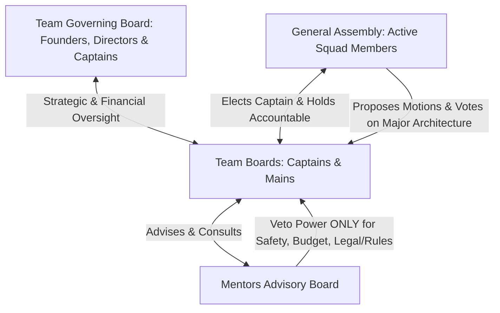
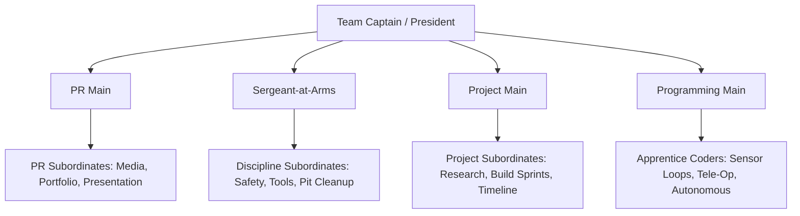

# 02. Governance, Democracy & Elections

---

## 🏛️ Principles of Democratic Governance

The RoboRangers operate as a **student-directed, mentor-advised democracy**. We believe that technical competence flourishes when members possess agency, accountability, and a formal voice in team decisions.

### Checks and Balances

---

## 👥 The Governing Bodies

### 1. The Team Governing Board (Strategic & Executive Level)
* **Scope**: Long-term organizational strategy, institutional finances, course-to-team pipelines, external school team partnerships, and legal/safety compliance.
* **Composition**: Head Coach / Founder, Technical Director, Operations & Finance Director, and Student Varsity Captain(s).
* **Authority**:
  * Approves organizational budgets, course tuition rates, and competition sponsorships.
  * Oversees the founding of new satellite school teams and appointment of RoboRanger Ambassadors.
  * Final appellate authority for code-of-conduct reviews and alumni ethics policies.

### 2. The General Assembly (GA)
* **Composition**: All registered, active student members in good standing within their respective competition squad (TerraByte, Junior FTC, or Varsity).
* **Powers**:
  * Elects team officers.
  * Debates and votes on major game strategies, robot design archetypes, and team policies.
  * Holds officers accountable through petitions of review or votes of no confidence.

### 3. The Universal 5-Officer Team Board (Every Competition Team)
Every official competition squad within the RoboRangers organization—including **TerraByte (FLL)**, **Junior FTC**, and the **RoboRangers Varsity (FTC)**—must maintain a 5-officer leadership board:

* **Team Captain (President)**: Meeting moderation, 4-stage meeting rhythm (Standup, Sprint, Testing, Pack-down), overall team coordination, and primary liaison to adult mentors.
* **PR Main**: Manages public relations, engineering portfolio/notebook, judging presentations, pit displays, and photo/video media capture. Oversees subordinate PR crew.
* **Sergeant-at-Arms**: Maintains workshop and pit discipline, meeting focus, safety compliance (PPE), and enforces the *"No cleanup, no robot testing"* rule. Oversees lab marshals and tool keepers.
* **Project Main**: Tracks deadlines, deliverables, and sprint tasks. In FLL (TerraByte), leads the real-world Innovation Project. In FTC squads, coordinates engineering sprint milestones. Oversees subordinate project assistants.
* **Programming Main**: Responsible for code quality, autonomous consistency, sensor integration, tele-op mapping, and version control (GitHub/backups). Oversees apprentice coders.

#### Subordination & Mentorship Principle
The Mains are never solo workers. Every junior member in a squad is assigned as a **subordinate/apprentice** to one of the Mains based on their chosen specialization direction. A Main's leadership rating and **Trust Credits** depend directly on their ability to train and delegate to their subordinates.

### 4. The Mentor Advisory Board
* **Role**: Mentors serve as educators, facilitators, logistical guardians, and safety inspectors.
* **Non-Interference Standard**: Mentors do not cast votes in student elections, nor do they dictate robot design, autonomous strategies, or game tactics.
* **Veto Authority**: Mentors hold targeted veto power **strictly limited to**:
  1. Violations of workshop or personal physical safety.
  2. School, venue, or FIRST official rules violations.
  3. Budgetary insufficiency or financial risk.
  4. Violations of the Team Code of Conduct.

---

## 🗳️ Voting Thresholds & Decision Protocol

Decisions are classified into four tiers to balance speed with consensus:

| Tier | Decision Type | Quorum Required | Voting Threshold | Notes |
| :--- | :--- | :--- | :--- | :--- |
| **Tier 1: Daily Operations** | Routine schedule tweaks, minor hardware purchases (<$50), task assignments. | N/A | **Consensus or Sub-team Lead Decision** | Handled within relevant sub-teams. |
| **Tier 2: Standard Team Motions** | Meeting schedules, team apparel design, social events, minor budget line items. | 50% of Active Members | **Simple Majority ($50\% + 1$)** | Show of hands or voice vote in GA. |
| **Tier 3: Strategic Engineering** | Robot archetype selection, strategy direction, official Design Freeze sign-off. | 60% of Active Members | **Supermajority ($60\%$)** | Must follow an engineering trade study / decision matrix presentation. |
| **Tier 4: Constitutional & Elections** | Electing officers, amending Constitution, leadership recall/impeachment. | 75% of Active Members | **Three-Fourths ($75\%$) for Amendments / Absolute Majority for Elections** | Strictly secret ballot. |

---

## 🗳️ Annual Election Procedure

Elections are held annually at the end of the competitive season (typically April or May) to allow the incoming leadership council a summer onboarding and transition window.

### 1. Eligibility for Office
To run for an Executive Council position, a member must:
1. Have maintained an attendance record of at least **80%** during the preceding season.
2. Have completed at least one full competition season as an active RoboRangers member.
3. Be in good disciplinary and academic standing.

### 2. Candidacy & Nomination
- Nominations open two weeks prior to election day. Members may self-nominate or be nominated by peers.
- Each candidate submits a brief statement of purpose outlining their goals, vision, and qualifications.

### 3. The Hustings (Election Meeting)
- Each candidate delivers a 3-minute speech to the General Assembly.
- The GA holds a 5-minute moderated Q&A for each contested office.
- Mentors moderate the timekeeping to ensure strictly equal speaking time.

### 4. Secret Ballot Voting
- Voting is conducted via secret, anonymous ballots (paper or verified anonymous digital forms).
- A candidate must secure a simple majority ($>50\%$) of cast votes to win.
- **Runoff Election**: If three or more candidates run and none gains $>50\%$, a runoff election occurs between the top two candidates immediately.

---

## 🔄 Terms of Office, Vacancies & Recall

1. **Term**: Officers serve for a term of one calendar year (from June 1st through May 31st).
2. **Succession**: If a Team Captain steps down or is incapacitated, the Technical Lead assumes interim duties until a special election is convened within 14 days.
3. **Recall (Vote of No Confidence)**:
   - If an officer consistently fails to execute their duties, neglects attendance, or breaches team trust, any active member may file a written recall petition backed by signatures of at least **33% of the active team**.
   - The Executive Council and Mentors schedule a formal hearing within 7 days.
   - The officer has the right to address the General Assembly.
   - Removal requires a **two-thirds ($66\%$) secret-ballot vote** of all active members.
