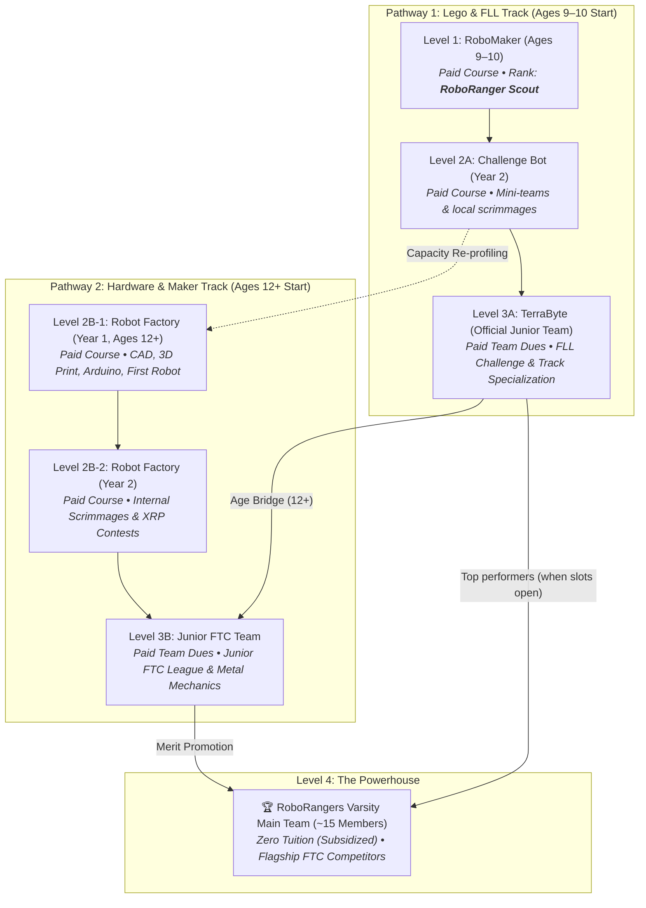

# 04. Membership, Attendance & Travel Eligibility

---

## 🎖️ The 4-Tier Membership Architecture & Financial Model

Every student entering the organization is a **RoboRanger from Day 1**. To balance accessibility, mentorship resources, and competitive excellence, membership is organized into four progressive levels:

---

### Detailed Tier Specifications

| Level / Team | Target Ages & Programs | Financial Model | Advancement Milestone |
| :--- | :--- | :--- | :--- |
| **Level 1: Ranger Explorer** | Ages 9–10 (*RoboMaker*) | **Paid Course Tuition** (Covers instructor, kit access, and workshop overhead). | Graduates earn the official rank of **RoboRanger Scout** and receive their member Passport. |
| **Level 2A: Ranger Challenger** | Ages 9–11 (*Challenge Bot*) | **Paid Course Tuition**. Focus on mini-teams, mechanisms, and local scrimmages. | Internal scrimmage ranking and Passport badge completion. |
| **Level 2B: Robot Factory** | Ages 12+ (*Robot Factory: Years 1 & 2*) | **Paid Course Tuition**. Focus on CAD, 3D printing, electronics, Arduino, and XRP robotics. | Evolution to internal competitions and Junior FTC readiness. |
| **Level 3A: TerraByte** | Ages 9–13 (*Official FLL Junior Team*) | **Paid Team Dues** (Covers FLL registration, mat elements, specialized kits, and mentors). | Official FLL competitions; track specialization; potential multi-year tenure (1–3 yrs). |
| **Level 3B: Junior FTC Team** | Ages 12–15 (*Junior Varsity FTC Squad*) | **Paid Team Dues** (Covers FTC registration, goBILDA/REV hardware, workshop access). | Junior FTC tournaments; scrimmages against Varsity; proven track mastery. |
| **Level 4: RoboRangers Varsity** | High School / Top ~15 Candidates | **ZERO Tuition (Subsidized)**. Parents only cover direct personal expenses (travel, hotel, team jacket). | Full voting rights in General Assembly; flagship international FTC competition. |

---

## 🔀 Pathways, Capacity Re-Profiling & Satellite Ambassadors

### 1. Dual Pathway Flexibility & Capacity Re-Profiling
* **TerraByte Capacity Safeguard**: If a *Challenge Bot* graduate is ready to compete but TerraByte’s roster is at capacity, the student is offered priority **re-profiling into Robot Factory** (if aged 11–12+). This channels their enthusiasm into advanced metal and 3D printing rather than turning them away.
* **Multi-Year Tenure in Level 3**: Students may remain in TerraByte or Junior FTC for multiple seasons. A 2nd- or 3rd-year junior member steps up as a **Junior Team Captain** or **Main**, gaining invaluable leadership experience before advancing.

### 2. The Satellite School Team Ambassador Program
Because the RoboRangers found and mentor robotics programs across local schools, experienced members in Level 3 who are ready for leadership (even while Main Team seats are full) may be deployed as **RoboRanger Ambassadors**:
* **Role**: Appointed as student team captain, co-captain, or lead mentor for a partner school team.
* **Privileges**: Retains full RoboRanger status, wears the RoboRangers Ambassador insignia, and gains prime eligibility for the Main Varsity Team upon vacancy.
* **Ethics & IP**: Ambassadors teach engineering methods and FIRST Core Values, but may not transfer proprietary RoboRangers Varsity software libraries or CAD design files to external school teams.

### 3. Lateral Entry Protocol (External Candidates)
If a non-academy student applies directly for Level 4 (Varsity):
1. **Verifiable Proof**: Must submit an engineering portfolio, GitHub repo, or past competition record (FTC/FRC/FLL finalist).
2. **Technical & Values Interview**: Evaluated by the Team Captain, Programming Main, and Mentors.
3. **30-Day Provisional Status**: Candidate must complete a 30-day probationary trial before full voting Varsity membership is granted.

---

## 📘 The Self-Driven "Ranger Passport" & Leadership Points

To foster student ownership and prevent mentor administrative burnout:
1. **Student Responsibility**: Every member maintains a physical or digital **Ranger Passport** logging workshop hours, project reflections, safety certifications, and skill badges.
2. **Sub-Team Sign-Offs**: Mains sign off on their subordinate members' task completions; Mentors verify milestones at seasonal promotion hearings.
3. **Leadership Points & Recognition**: Members who serve as a **Team Captain**, **PR Main**, **Sergeant-at-Arms**, **Project Main**, or **Programming Main** earn accelerated Leadership Points required for promotion to Level 4.
4. **Volunteering Certificates & Hour Verification**: All verified hours spent mentoring younger courses, assisting in the workshop, or leading satellite school teams are certified with **Official RoboRangers Volunteering Certificates**, usable for school community service requirements, college applications, and international STEM resumes.

---

## 🤝 Youth Volunteering & Junior Mentorship Program (Ages 14+)

Starting at **age 14**, any active RoboRanger may officially contribute their effort to the broader organization's growth through structured non-technical, leadership, and volunteer activities:

1. **Approved Volunteering Pathways**:
   * **Junior Mentoring**: Assisting adult coaches during *RoboMaker* and *Challenge Bot* sessions—helping 9–11-year-olds troubleshoot mechanisms and model FIRST Core Values.
   * **Community & Public Presentations**: Demonstrating robots at partner schools, open house exhibitions, sponsor meetings, and community festivals.
   * **Creative Video & Media Production**: Directing, filming, and editing robot reveal videos, match highlight reels, tutorials, and social media reels.
   * **Organizing Fun & Team Culture Events**: Planning team social nights, scrimmage game boards, robot sumo tournaments, and celebration banquets (critical for morale and preventing technical burnout).

2. **Repayment & Protection Standards**:
   * All volunteering is strictly voluntary, aligned with the member's personal interests, and balanced with their academic schedule.
   * Every hour is recorded in their Ranger Passport and formally repaid with **Official Volunteering Certificates** and **Trust Credits** toward Level 4 Varsity promotion.

---

## ⏱️ Attendance Standards

Consistency is the foundation of competitive robotics. Because sub-teams depend on synchronized collaboration, attendance expectations are strictly maintained:

### 1. The 80% Standard
* All active members are expected to maintain at least **80% attendance** at official scheduled work sessions and team meetings throughout the active season (Kickoff through State/Championship events).
* Attendance is recorded via the official team check-in sheet or digital kiosk at the beginning and end of each session.

### 2. Excused vs. Unexcused Absences
* **Excused Absences**: Family emergencies, illness, mandatory religious observances, or major pre-notified academic commitments (exams, mandatory school events).
  * Must be reported to the Team Captain and Attendance Lead at least **24 hours in advance** (or as soon as possible in emergencies).
* **Unexcused Absences**: Skipping sessions without prior notice, social conflicts that could be rescheduled, or unverified claims.
  * Three (3) unexcused absences within a single semester trigger an automatic peer review and loss of travel priority.

### 3. Tardy Policy
* Arriving more than 20 minutes late without notification counts as a **half-absence**.
* Leaving early without authorization before cleanup is completed forfeits attendance credit for that session.

---

## 🛫 Competition & Travel Eligibility

Attending off-site tournaments, qualifiers, regionals, and world championships is a earned privilege. Space on travel rosters and pit passes are strictly capped by competition regulations.

To be eligible for travel on the official competition roster, a member must meet **all** of the following:

1. **Attendance Compliance**: Verified $\ge 80\%$ attendance record over the competition build period.
2. **Academic Standing**: Passing grades in all school courses; no failing or incomplete marks.
3. **Safety Certification**: Current safety test passed with 100% score on file.
4. **Active Contribution**: Demonstrated, logged contribution to either the robot hardware/software, Engineering Portfolio, or outreach initiatives.
5. **Dues & Financial Equity**: 
   - Team dues (if applicable) paid or formally waived.
   - *Financial Hardship Waiver*: No student will ever be excluded from RoboRangers due to financial hardship. Confidential waivers or sponsored scholarships are managed by the Head Coach/Mentors.

---

## ⏸️ Leave of Absence & Voluntary Resignation

* **Academic Break / Leave of Absence**: A member may request a temporary leave of absence (up to 4 weeks) for intense academic periods or health reasons without losing their active tier, provided they notify the Executive Council in writing.
* **Resignation**: Members wishing to step down should submit a brief written notification so tasks and credentials can be cleanly reassigned. All team tools, shirts, and hardware must be returned.
