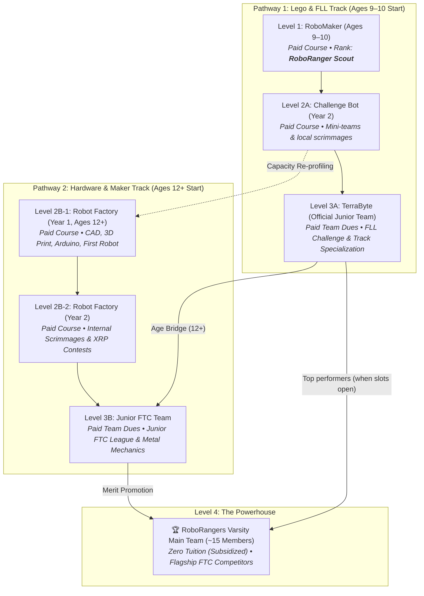

# 04. Membership, Attendance & Travel Eligibility

---

## 🎖️ The 4-Tier Membership Architecture & Financial Model

Every student entering the organization is a **RoboRanger from Day 1**. To balance accessibility, mentorship resources, and competitive excellence, membership is organized into four progressive levels:



---

### Detailed Tier Specifications

| Level / Team | Target Ages & Programs | Financial Model | Advancement Milestone |
| :--- | :--- | :--- | :--- |
| **Level 1: Ranger Explorer** | Ages 9–10 (*RoboMaker*) | **Paid Course Tuition** (Covers instructor, kit access, and workshop overhead). | Graduates earn the official rank of **RoboRanger Scout** and receive their member Passport. |
| **Level 2A: Ranger Challenger** | Ages 9–11 (*Challenge Bot*) | **Paid Course Tuition**. Focus on mini-teams, mechanisms, and local scrimmages. | Internal scrimmage ranking and Passport badge completion. |
| **Level 2B: Robot Factory** | Ages 12+ (*Robot Factory: Years 1 & 2*) | **Paid Course Tuition**. Focus on CAD, 3D printing, electronics, Arduino, and XRP robotics. | Evolution to internal competitions and Junior FTC readiness. |
| **Level 3A: TerraByte** | Ages 9–13 (*Official FLL Junior Team*) | **Paid Team Dues** (Covers FLL registration, mat elements, specialized kits, and mentors). | Official FLL competitions; track specialization; potential multi-year tenure (1–3 yrs). |
| **Level 3B: Junior FTC Team** | Ages 12–15 (*Junior Varsity FTC Squad*) | **Paid Team Dues** (Covers FTC registration, goBILDA/REV hardware, workshop access). | Junior FTC tournaments; scrimmages against Varsity; proven track mastery. |
| **Level 4: RoboRangers Varsity** | High School / Top ~15 Candidates | **ZERO Tuition (Subsidized)**. Parents only cover direct personal expenses (travel, hotel, team jacket). | Full voting rights in General Assembly; flagship international FTC competition. |

---

## 🔀 Pathways, Capacity Re-Profiling & Satellite Ambassadors

### 1. Dual Pathway Flexibility & Capacity Re-Profiling
* **TerraByte Capacity Safeguard**: If a *Challenge Bot* graduate is ready to compete but TerraByte’s roster is at capacity, the student is offered priority **re-profiling into Robot Factory** (if aged 11–12+). This channels their enthusiasm into advanced metal and 3D printing rather than turning them away.
* **Multi-Year Tenure in Level 3**: Students may remain in TerraByte or Junior FTC for multiple seasons. A 2nd- or 3rd-year junior member steps up as a **Junior Team Captain** or **Main**, gaining invaluable leadership experience before advancing.

### 2. The Satellite School Team Ambassador Program
Because the RoboRangers found and mentor robotics programs across local schools, experienced members in Level 3 who are ready for leadership (even while Main Team seats are full) may be deployed as **RoboRanger Ambassadors**:
* **Role**: Appointed as student team captain, co-captain, or lead mentor for a partner school team.
* **Privileges**: Retains full RoboRanger status, wears the RoboRangers Ambassador insignia, and gains prime eligibility for the Main Varsity Team upon vacancy.
* **Ethics & IP**: Ambassadors teach engineering methods and FIRST Core Values, but may not transfer proprietary RoboRangers Varsity software libraries or CAD design files to external school teams.

### 3. Lateral Entry Protocol (External Candidates)
If a non-academy student applies directly for Level 4 (Varsity):
1. **Verifiable Proof**: Must submit an engineering portfolio, GitHub repo, or past competition record (FTC/FRC/FLL finalist).
2. **Technical & Values Interview**: Evaluated by the Team Captain, Programming Main, and Mentors.
3. **30-Day Provisional Status**: Candidate must complete a 30-day probationary trial before full voting Varsity membership is granted.

---

## 📘 The Self-Driven "Ranger Passport", Cumulative XP & Governance

To foster student ownership, reward multi-year loyalty, and prevent mentor administrative burnout:
1. **Cumulative Lifetime XP (Permanent Progression)**: Every member maintains an official **Ranger Passport** logging workshop hours, project reflections, safety certifications, and skill badges. Points (**Ranger XP**) **never reset across seasons**; they accumulate cumulatively from initial entry through Varsity and Alumni status, permanently honoring every hour dedicated to the team.
2. **Dual Sign-Off Protocol**:
   * **Tier 1 (Student Mains Approval)**: The 5 Board Mains have direct authority to sign off on day-to-day subordinate sprint tasks, meeting check-ins, and task XP (+25 to +50 XP).
   * **Tier 2 (Mentor Verification)**: Mentors Florin Cazac and Andrian Bocancea hold exclusive verification authority for **Milestone Badges**, **Rank Advancements (Vanguard/Master)**, and **Official Volunteering Certificates**.
3. **The 4-Gate Flight Pass (Travel Eligibility Radar)**: While lifetime XP is cumulative, eligibility for off-site competition travel rosters (e.g., FTC Romania Regional, FTC Italy, FIRST Global) is strictly governed each season by an objective 4-gate radar:
   * Current season attendance rate $\ge 80\%$.
   * 100% Safety Exam clearance on file for the active year.
   * Minimum $\ge 15$ verified community volunteering hours.
   * Primary ownership of at least one functional robot subsystem or organizational deliverable.
4. **Mandatory Educational Repayment**: All verified hours spent mentoring younger squads (*RoboMaker*, *Challenge Bot*), organizing TAK scrimmages, or presenting at public expos (Port Mall, Tekwill, Maker Faire) are formally certified with **Official RoboRangers Volunteering Certificates** usable for school graduation credits, university applications, and international STEM resumes.

---

## 🤝 Youth Volunteering & Junior Mentorship Program (Ages 14+)

Starting at **age 14**, any active RoboRanger may officially contribute their skills and energy to the broader community and organization through three structured, accredited volunteering tracks:

### 1. The Three Approved Volunteering Tracks

```text
 ┌─────────────────────────────────────────────────────────────────────────────┐
 │ TRACK A: Public Exhibition & Outreach Ambassador                            │
 │ • Staffing official team expo booths (Port Mall, Tekwill Expo, Maker Faire) │
 │ • Operating live robot demonstration arenas and explaining engineering logs │
 │ • Speaking with public visitors, youth recruits, and prospective sponsors   │
 └─────────────────────────────────────────────────────────────────────────────┘
                                       ▲
 ┌─────────────────────────────────────┴───────────────────────────────────────┐
 │ TRACK B: Event & Competition Official                                       │
 │ • Certified match referees and field reset marshals at internal tournaments │
 │ • Robot inspection assistants, queueing coordinators, and pit display staff │
 │ • Scorekeepers and live audio/video streaming crew for TAK & scrimmages    │
 └─────────────────────────────────────────────────────────────────────────────┘
                                       ▲
 ┌─────────────────────────────────────┴───────────────────────────────────────┐
 │ TRACK C: Junior Course Mentor & Assistant Coach                             │
 │ • Co-teaching and assisting adult mentors in RoboMaker & Challenge Bot labs │
 │ • Guiding younger students (ages 9–11) through basic CAD, wiring, and code  │
 │ • Stepping in for scheduled module coverage under adult mentor co-oversight │
 └─────────────────────────────────────────────────────────────────────────────┘
```

#### Detailed Track Rules:
* **Track A (Outreach & Exhibition Ambassador)**:
  * *Focus*: Public communication, robot showcases, sponsor networking, and STEM advocacy.
  * *Safeguards*: Maximum 4-hour active booth shifts; mandatory buddy system (minimum 2 students per stand); continuous mentor point of contact.
* **Track B (Tournament & Competition Official)**:
  * *Focus*: Rulebook mastery, fair play enforcement, field management, and tournament logistics.
  * *Safeguards*: Formal rule briefing required prior to matches; adult Head Referee has final decision authority in case of coach disputes.
* **Track C (Junior Course Mentor & Assistant Coach)**:
  * *Focus*: Pedagogical leadership, technical coaching, and role-modeling FIRST Core Values for younger generations.
  * *Child Protection & Anti-Exploitation Boundary*: Junior mentors are strictly **student assistants and role models**, never unpaid commercial replacements. An adult academy coach remains legally and operationally responsible for the classroom at all times.

### 2. Mandatory Repayment & Anti-Exploitation Safeguards
* **Strictly Educational & Voluntary**: All volunteer assignments must be 100% voluntary, aligned with the student's personal growth goals, and must never interfere with their school performance or exam periods.
* **Passport XP & Certificate Repayment**: Every single hour is officially logged in the student's Ranger Passport (at +50 XP/hr) and certified through **Official RoboRangers Volunteering Certificates** recognized for national/international graduation credits and university admissions.
* **Travel Pass Credits**: High volunteering loyalty directly fulfills Gate 3 of the 4-Gate Travel Flight Pass, earning students top-tier consideration for subsidized international travel rosters.

---

## 🎖️ The Multi-Faceted Return: Repaying Member Loyalty Beyond Competition Travel

While representing Moldova at international championships (such as FTC Internationals, FIRST Global Challenge, or European Opens) is a pinnacle experience, travel rosters are strictly capped by competition rules and budget constraints. 

To prevent **team delamination** and ensure that every RoboRanger feels valued and rewarded year-round—regardless of whether they fly to an off-site event—the organization provides four non-travel pillars of return:

1. **Official Verified Volunteering Certificates**:
   * Every semester, members in good standing receive official certificates detailing logged hours in STEM mentorship, hardware maintenance, software development, and community outreach.
   * These credentials carry official weight for high school graduation requirements, Erasmus programs, university admissions, and international scholarship applications.
2. **Public Media Credit & Portfolio Features**:
   * The PR team actively spotlights members on the official website blog, Instagram, and Facebook.
   * Technical solutions, CAD mechanisms, and code commits are attributed to their student creators, giving members a verifiable public portfolio for future careers.
3. **Internal Championship Glory ("The Ranger Cup")**:
   * Off-season robot-sumo competitions, obstacle runs, and internal hackathons award official team medals, trophies, and peer accolades celebrated across the entire academy.
4. **Lifelong Alumni Network & Professional Mentorship**:
   * Dedicated members gain entry into the elite network of RoboRangers alumni dating back to 2015—connecting them with university students, tech industry professionals, and career guidance.

---

## ⏱️ Attendance Standards

Consistency is the foundation of competitive robotics. Because sub-teams depend on synchronized collaboration, attendance expectations are strictly maintained:

### 1. The 80% Standard
* All active members are expected to maintain at least **80% attendance** at official scheduled work sessions and team meetings throughout the active season (Kickoff through State/Championship events).
* Attendance is recorded via the official team check-in sheet or digital kiosk at the beginning and end of each session.

### 2. Excused vs. Unexcused Absences
* **Excused Absences**: Family emergencies, illness, mandatory religious observances, or major pre-notified academic commitments (exams, mandatory school events).
  * Must be reported to the Team Captain and Attendance Lead at least **24 hours in advance** (or as soon as possible in emergencies).
* **Unexcused Absences**: Skipping sessions without prior notice, social conflicts that could be rescheduled, or unverified claims.
  * Three (3) unexcused absences within a single semester trigger an automatic peer review and loss of travel priority.

### 3. Tardy Policy
* Arriving more than 20 minutes late without notification counts as a **half-absence**.
* Leaving early without authorization before cleanup is completed forfeits attendance credit for that session.

---

## 🛫 Competition & Travel Eligibility

Attending off-site tournaments, qualifiers, regionals, and world championships is a earned privilege. Space on travel rosters and pit passes are strictly capped by competition regulations.

To be eligible for travel on the official competition roster, a member must meet **all** of the following:

1. **Attendance Compliance**: Verified $\ge 80\%$ attendance record over the competition build period.
2. **Academic Standing**: Passing grades in all school courses; no failing or incomplete marks.
3. **Safety Certification**: Current safety test passed with 100% score on file.
4. **Active Contribution**: Demonstrated, logged contribution to either the robot hardware/software, Engineering Portfolio, or outreach initiatives.
5. **Dues & Financial Equity**: 
   - Team dues (if applicable) paid or formally waived.
   - *Financial Hardship Waiver*: No student will ever be excluded from RoboRangers due to financial hardship. Confidential waivers or sponsored scholarships are managed by the Head Coach/Mentors.

---

## ⏸️ Leave of Absence & Voluntary Resignation

* **Academic Break / Leave of Absence**: A member may request a temporary leave of absence (up to 4 weeks) for intense academic periods or health reasons without losing their active tier, provided they notify the Executive Council in writing.
* **Resignation**: Members wishing to step down should submit a brief written notification so tasks and credentials can be cleanly reassigned. All team tools, shirts, and hardware must be returned.
