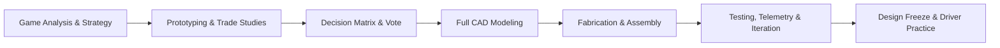

# 06. Engineering Workflow, Design Process & Standards

---

## ⚙️ The RoboRangers Engineering Cycle

We adhere to a formal iterative engineering design process. We avoid "trial-and-error without logging"; every iteration is deliberate, recorded, and justified through data.



---

## 📊 Concept Selection & The Decision Matrix

When selecting game mechanisms (e.g., linear slide vs. virtual four-bar linkage, wheeled intake vs. claw), the team relies on objective evaluation rather than subjective debate.

### The Trade Study Protocol
1. Sub-teams build rapid, low-fidelity cardboard/wood/extrusion prototypes.
2. Prototypes are scored on a standardized **Weighted Decision Matrix**:

| Criterion | Weight | Concept A (e.g. Claw) | Concept B (e.g. Roller Intake) |
| :--- | :---: | :---: | :---: |
| **Cycle Speed** | $25\%$ | 3 / 5 | 5 / 5 |
| **Mechanical Reliability** | $25\%$ | 4 / 5 | 4 / 5 |
| **Ease of Manufacturing & CAD** | $20\%$ | 4 / 5 | 2 / 5 |
| **Software Complexity** | $15\%$ | 5 / 5 | 3 / 5 |
| **Weight & CG Impact** | $15\%$ | 4 / 5 | 3 / 5 |
| **Weighted Total** | **100%** | **3.80** | **3.65** |

3. The results are presented to the General Assembly. If scores are within 5%, a Tier 3 Democratic Vote (60% threshold) resolves the final direction.

---

## 💻 CAD Standards ("CAD First" Principle)

### 1. The Golden Rule
> **"If it is not modeled in CAD, it does not get cut, printed, or assembled."**

Building without CAD leads to spatial interference, improper gear mesh, and wasted materials.

### 2. CAD Requirements (Onshape / Fusion 360)
* All custom plates, brackets, and 3D printed parts must be fully constrained in the team's official workspace.
* Off-the-shelf COTS components (REV Robotics, goBILDA, AndyMark, Actobotics) must use official vendor CAD models.
* Assemblies must include motion limits to detect physical collisions before fabrication.
* Weight properties must be tracked to guarantee compliance with the official robot weight limit.

---

## 🧑‍💻 Software Development & Version Control Standards

### 1. Git Repository Hygiene
* The team maintains a single authoritative GitHub repository.
* Direct commits to the `main` or `release` branches are strictly blocked.
* Developers work on feature branches named with descriptive prefixes:
  * `feature/auto-5-sample`
  * `fix/arm-pid-oscillation`
  * `tuning/odometry-offsets`
* Merging into `main` requires:
  1. A formal Pull Request (PR) with video proof of real-robot or simulator testing.
  2. Approval from the Software Lead or a designated senior programmer.

### 2. Code Quality & Safety Fallbacks
* Hardware mapping must never crash the robot app if a sensor is disconnected (use `try-catch` blocks or null-safety patterns).
* Motor telemetry, battery voltage, and limit-switch states must be logged for post-match diagnostics.
* Emergency stop (E-Stop) commands must be mapped to intuitive gamepad combinations.

---

## 🧊 The Design Freeze Protocol

The single greatest point of failure for competitive teams is redesigning the robot days before an event. The RoboRangers enforce a strict **Three-Week Design Freeze**:

```text
  Kickoff ────────► Prototyping ────────► Alpha Robot ────────► [DESIGN FREEZE] ────────► Competition
   (Week 1)          (Weeks 2-4)           (Weeks 5-8)          (3 WEEks Out)           (Week 11)
                                                                      │
                                                ┌─────────────────────┴─────────────────────┐
                                                │ NO STRUCTURAL REDESIGNS PERMITTED         │
                                                │ Focus: Autonomous Path Tuning             │
                                                │ Driver Drills & Scrimmages                │
                                                │ Engineering Portfolio Finalization        │
                                                │ Pre-Match Checklists & Spare Parts        │
                                                └───────────────────────────────────────────┘
```

* **Exceptions**: An emergency design modification past the Freeze date requires unanimous sign-off by the Team Captain, Mechanical Lead, Software Lead, and Head Coach.

---

## 📖 The Engineering Portfolio & Documentation

Documentation is treated with the exact same prestige as the physical robot.

1. **Daily Log Entries**: Every sub-team must write a brief entry at the end of each session detailing:
   * What was built/programmed.
   * What failed or produced unexpected results.
   * Next steps for the following session.
2. **Failure Analysis & Math**: Top judges look for iterations driven by physics calculations (gear ratios, torque requirements, center-of-gravity) and honest reflections on early prototypes that failed.
3. **Curating the 15-Page Portfolio (FTC)**: The Portfolio Lead leads a layout sprint starting 4 weeks before the competition, ensuring equal representation of engineering, programming, outreach, and business sustainability.
