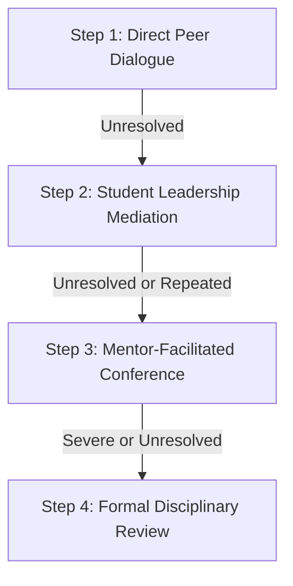

# 08. Conflict Resolution, Disciplinary System & Grievance Procedures

---

## 🕊️ Philosophy on Conflict

In an intensive engineering environment where stakes are high and deadlines loom, technical disagreements and interpersonal friction will naturally occur. The RoboRangers view constructive debate as essential for engineering progress. However, personal hostility, toxic conduct, and persistent disruption undermine the team's mission and will not be tolerated.

---

## 🪜 The Four-Step Resolution Pathway



### Step 1: Direct Peer Dialogue
* Members experiencing friction are encouraged to hold a calm, respectful one-on-one conversation outside of active build time.
* Focus on the issue and behavior, not the person: *"When task assignments aren't updated, it delays my testing,"* rather than *"You're lazy."*

### Step 2: Student Leadership Mediation
* If direct dialogue fails, the involved parties may request mediation from the Team Captain or an impartial Sub-Team Lead.
* The mediator listens to both perspectives separately, then convenes a joint session to agree on actionable behavioral expectations.

### Step 3: Mentor-Facilitated Conference
* If interpersonal issues persist, or if the dispute involves sub-team leads or captains, the Head Coach/Mentors step in.
* Mentors document the issue and establish a formal written agreement outlining expectations and follow-up check-ins.

### Step 4: Formal Disciplinary Review
* Reserved for persistent infractions, safety violations, or severe breaches of the Code of Conduct. Handled by the joint Executive Council and Mentor Board.

---

## ⚠️ The Progressive Three-Strike Disciplinary System

For violations of the Constitution, workshop safety rules, or the Code of Conduct, the following progressive system applies:

```text
 ┌─────────────────────────────────────────────────────────────┐
 │ STRIKE 1: Formal Warning & Counseling                       │
 │ Written notice in team records; private counseling session  │
 │ with Captain and Mentor; remediation plan established.     │
 └──────────────────────────────┬──────────────────────────────┘
                                ▼
 ┌─────────────────────────────────────────────────────────────┐
 │ STRIKE 2: Suspension & Competition Disqualification         │
 │ Two-week suspension from workshop sessions; forfeiture of   │
 │ voting rights and removal from upcoming tournament roster.  │
 └──────────────────────────────┬──────────────────────────────┘
                                ▼
 ┌─────────────────────────────────────────────────────────────┐
 │ STRIKE 3: Expulsion from the RoboRangers                    │
 │ Permanent removal from team membership. Requires joint      │
 │ confirmation by Executive Council and Head Coach.           │
 └─────────────────────────────────────────────────────────────┘
```

### Automatic Escalation (Immediate Strike 3)
The following actions bypass progressive discipline and result in immediate suspension and potential instant expulsion:
* Physical violence, threats, or severe harassment/bullying.
* Intentional sabotage of the team robot, code repository, or an opposing team's equipment.
* Possession of weapons, alcohol, or illicit substances on team premises or travel trips.
* Blatant and willful violation of major safety protocols that endangered human life.

---

## 📬 Anonymous Grievance & Safe Reporting

To ensure every member feels safe speaking up without fear of peer retaliation:
1. The team provides a dedicated **Anonymous Reporting Channel** (secure digital form or physical drop box managed directly by the Lead Mentor).
2. All reports are investigated with confidentiality and impartiality.
3. Retaliation against any member who files a report in good faith is grounds for immediate disciplinary suspension.

---

## ⚖️ Due Process, Rights of Appeal & Reinstatement

1. **Right to Be Heard**: Prior to any suspension or expulsion vote, the accused member has the right to present their perspective, introduce relevant context, and bring a parent or mentor advocate to the hearing.
2. **Right of Appeal**: Any disciplinary action may be appealed within **7 days** of delivery. Appeals are reviewed by a three-person panel consisting of the Head Coach, an uninvolved Mentor, and an elected student officer.
3. **Reinstatement**: A suspended member in good standing who completes their probationary requirements and demonstrates genuine restitution may be restored to active status upon approval of the Executive Council.
