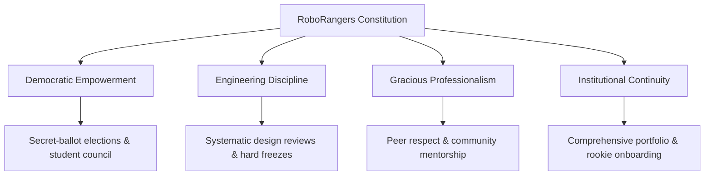

# The RoboRangers Team Codex & Constitution
**Version 0.1 (Working Draft & Foundation)**  
*Official Governance, Operating Procedures, and Academy Architecture — Celebrating over a decade of robotics excellence across FLL, FTC, and open robotics divisions.*

---

## 📜 Preamble

For over ten years, the **RoboRangers** have built not only competitive robots, but leaders, engineers, problem solvers, and innovators. As our team grows and tackles increasingly complex challenges across FLL, FTC, and beyond, this Constitution establishes a formal system of democratic governance, shared responsibility, technical discipline, and cultural continuity.

This document serves as the supreme operational standard of the RoboRangers. It guarantees that our team is student-driven, mentor-guided, democratically governed, and grounded in mutual respect and engineering rigor.

---

## 🗂️ Table of Contents

| File | Title | Description |
| :--- | :--- | :--- |
| **[01-core-values-and-mission.md](file:///c:/Users/keybord/Desktop/projects/RoboRangersConstitution/01-core-values-and-mission.md)** | Core Values & Mission | Team ethos, the 10-year legacy, FIRST principles, and general code of conduct. |
| **[02-governance-and-elections.md](file:///c:/Users/keybord/Desktop/projects/RoboRangersConstitution/02-governance-and-elections.md)** | Governance & Democracy | Team Governing Board, universal 5-officer team boards, checks & balances, and democratic election procedures. |
| **[03-team-roles-and-duties.md](file:///c:/Users/keybord/Desktop/projects/RoboRangersConstitution/03-team-roles-and-duties.md)** | Roles & Responsibilities | Universal 5 Mains (Captain, PR, Sergeant-at-Arms, Project, Programming), subordinate apprentice crews, and track directions. |
| **[04-membership-and-attendance.md](file:///c:/Users/keybord/Desktop/projects/RoboRangersConstitution/04-membership-and-attendance.md)** | Membership & Attendance | 4-tier membership, dual pathways (Lego/FLL & Hardware/FTC), Ranger Scout rank, Ranger Passport, and Satellite School Ambassadors. |
| **[05-lab-safety-and-equipment.md](file:///c:/Users/keybord/Desktop/projects/RoboRangersConstitution/05-lab-safety-and-equipment.md)** | Workshop Safety & Equipment | Personal Protective Equipment (PPE), tool operation, battery safety protocols, and lab hygiene. |
| **[06-engineering-and-process.md](file:///c:/Users/keybord/Desktop/projects/RoboRangersConstitution/06-engineering-and-process.md)** | Engineering & Design Process | Concept selection, decision matrices, CAD standards, Git workflows, design freezes, and documentation. |
| **[07-competition-and-drive-team.md](file:///c:/Users/keybord/Desktop/projects/RoboRangersConstitution/07-competition-and-drive-team.md)** | Competition & Drive Team | Objective driver tryouts, pit crew operations, match scouting, alliance diplomacy, and tournament etiquette. |
| **[08-conflict-resolution.md](file:///c:/Users/keybord/Desktop/projects/RoboRangersConstitution/08-conflict-resolution.md)** | Conflict Resolution & Discipline | Progressive 3-strike disciplinary procedure, peer mediation, grievance reporting, and appeals. |

---

## 🏛️ Guiding Pillars of the RoboRangers

---

## ✍️ Ratification and Amendments

1. **Ratification**: This Constitution comes into effect immediately upon a two-thirds ($66\%$) affirmative vote of active team members and unanimous endorsement by the head coaching staff.
2. **Amendments**: Any active member may propose a constitutional amendment. Proposed amendments require a 14-day review period followed by a three-fourths ($75\%$) supermajority vote of all active voting members.
3. **Annual Review**: During the post-season review (April/May), the incoming and outgoing leadership councils shall review this document to adapt to updated competition rules and team growth.
